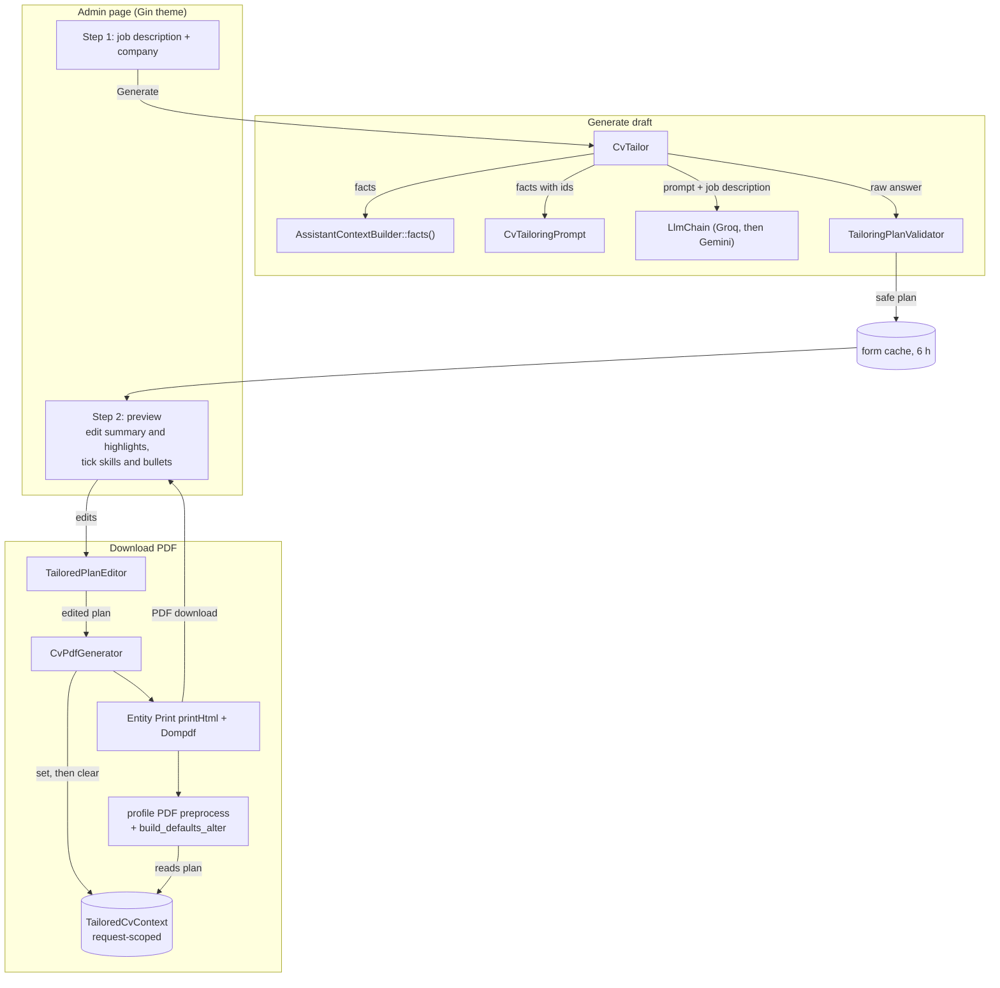

# Technical study: an AI-tailored CV that cannot invent facts

**Status:** in production code on `main` since 2026-10-23 · **Last verified against the code:** 2026-10-23
**Design spec:** [`docs/specs/2026-10-22-tailored-cv-design.md`](../specs/2026-10-22-tailored-cv-design.md)

## 1. Summary

The tailored CV is a private Drupal admin page that turns a pasted job description into a one-page
PDF CV aimed at that role. The model never writes the CV. It returns a **plan that references
existing facts by id**. A validator throws away anything that does not exist, the owner edits the
result, and Entity Print renders it with the same template as the public CV.

| Aspect | What we built |
|---|---|
| Platform | Drupal 11.3, PHP 8.3, Form API, Entity Print with the Dompdf engine, one custom module (`portfolio_core`) |
| Source of truth | The published `profile` node: summary, work experience paragraphs with achievement bullets, skills by category, certifications, availability, and the owner-only "Extra knowledge" lines |
| Trigger | The owner pastes a job description at `/admin/portfolio/tailored-cv` and presses "Generate draft" |
| AI | The same Groq → Gemini fallback chain as the site's chat assistant ([Droopy study](droopy-ai-guide.md)), 1,200-token budget, one JSON object per answer |
| Honesty check | `TailoringPlanValidator`: unknown ids and skills are dropped; repeats, pronouns, a missing years figure, and skill names or numbers a highlight adds beyond its source are flagged or removed |
| Storage | None in content or logs. The draft lives in Drupal's form cache, which expires after 6 hours |
| Output | `<Site-Name>-CV-<Company>.pdf`, rendered from `node--profile--pdf.html.twig` |
| Access | Permission `use tailored cv` (restricted); anonymous users get 403 |
| Custom code | 1,086 lines of PHP (8 classes in `src/Cv/` plus `TailoredCvForm`), about 40 lines of hooks in `portfolio_core.module`, a 22-line JS word counter, plus 811 lines of PHPUnit tests (51 tests) and 3 Playwright scenarios |

## 2. Does your use case match ours?

| Question | Our answer | If yours differs |
|---|---|---|
| Where do the facts live? | In structured Drupal fields: one bullet per line, skills as nodes with categories | If your CV is a single rich-text field or a PDF, split it into addressable items first; ids are the whole design |
| Who uses it? | One owner, logged in, tailoring their own CV | For many candidates (a careers service), the same code works per profile node, but add per-user access checks and flood control |
| What may the AI write? | Only the summary and up to three highlights; everything else is selected from existing text | If you want AI-reworded bullets, you lose the "nothing invented" guarantee and need a human review step for every line |
| How strict must honesty be? | Strict: no skill, employer, date or number that is not in the profile | If loose is fine, a plain "rewrite my CV" prompt is far simpler, and this design is overkill |
| What format do you need? | One A4 PDF from an existing Entity Print template | For DOCX or several templates, replace `CvPdfGenerator`; the plan and validator do not care about the format |
| Is it public? | No. Admin page only; the job description goes to a free-tier provider | A public version needs flood control, a length check in the service and a privacy notice about the provider |
| Volume | A few drafts per application; at most 20 drafts per hour per client | High volume needs a paid provider tier and higher limits; there is no queue or retry |

**Rule of thumb:** if your facts are structured and you need the AI to choose rather than write,
this design matches. The rows on where the facts live and what the AI may write decide it.

## 3. Architecture

The model only produces ids and two short texts. Everything that reaches the PDF passes the
validator, then the owner's preview, then the PDF preprocess hook. That hook swaps in the plan only
while `TailoredCvContext` holds one.

## 4. Implementation details

### 4.1 Access and entry points

| Piece | Detail |
|---|---|
| Route | `portfolio_core.tailored_cv` → `/admin/portfolio/tailored-cv`, `_form: TailoredCvForm`, `_admin_route: TRUE` |
| Permission | `use tailored cv`, `restrict access: true`; held only by the administrator role |
| Menu | `portfolio_core.links.menu.yml`: "Tailored CV" under Administration › Content |
| Chat shortcut | `portfolio_theme_preprocess_page()` adds a `tailor_url` prop to the Droopy component only for users with the permission, and adds the `user.permissions` cache context. In `droopy-guide.js`, typing exactly `/tailored-cv` (trimmed, case-insensitive) shows a local link to the tool, with no API call and nothing stored. Without the prop, the text is an ordinary question |

### 4.2 Facts with stable ids (`CvTailoringPrompt`)

- Facts come from `AssistantContextBuilder::facts()`, the same cached array the chat assistant uses.
- `compose()` writes them with ids the model must cite instead of retyping text:

| Fact | Id | Example line in the prompt |
|---|---|---|
| Job | `jN` (field order, from 1) | `[j1] Fullstack Developer at …` |
| Achievement bullet | `jN.bM` | `  [j1.b3] Integrated Acquia DAM with Drupal …` |
| Extra-knowledge line | `nK` | `[n2] …` |
| Certification | `cK` | `[c1] Certification: …` |
| Skill | its exact label | `Skills: Drupal, PHP, …` |

The rules ask for:
- **Summary:** at most 80 words, CV style with no personal pronouns, opening with the role and the
  total years.
- **Highlights:** up to 3, at most 20 words each, each citing one id. A highlight may not cite a
  bullet that also prints, and may not add tools from the job description.
- **Skills and bullets:** chosen and ordered, leaving out weak matches.
- **Gaps:** job requirements the facts don't cover.
- **Format:** English, plain text, no salary, and one JSON object in a fixed shape.

### 4.3 Getting a plan (`CvTailor`)

- `tailor()` sends the prompt as the system message and the trimmed job description as the only
  user message, through `LlmChain::complete()` with 1,200 tokens.
- Before the call it enforces its own limits, so any future caller gets them too: at most 6,000
  characters (`CvTailor::MAX_JOB_DESCRIPTION`, also the form's `#maxlength`), and at most 20
  drafts per hour per client (core flood event `portfolio_core.cv_tailor`). The draft is counted
  before the call, because failed drafts use provider quota too. Both throw
  `TailoringLimitException` with a code (`TOO_LONG`, `TOO_MANY`), and the form shows a specific
  message.
- A `NULL` from the chain (no provider answered) and any validator rejection both become a
  `RuntimeException`.
- The form shows "Couldn't build a draft, try again". The log line carries only the reason, never
  the job description or the answer.

### 4.4 The honesty check (`TailoringPlanValidator::validate()`)

1. **Parse.** It scans for the first balanced `{…}` that decodes as JSON, string-aware so braces
   inside strings don't count. This survives code fences and chatty prefixes. No object, or an
   empty summary, throws.
2. **Jobs.** Jobs the model omitted keep all their bullets, ticked. In a chosen job, valid
   `jN.bM` ids come first (ticked) and the remaining bullets follow unticked. Ids pointing at
   another job, unknown ids and duplicates are ignored. Each plan job also stores the work
   experience **paragraph id**. `TailoringPlanValidator::locateJob()` uses it at render time, so
   reordering experience while a draft is open never moves bullets to another job.
3. **Highlights.**
   - Sources are looked up in an id → text map (`jN.bM`, `nK`, `cK`). Unknown sources are dropped.
   - A highlight citing a bullet that will print is dropped as a repeat.
   - At most 3 are kept, each clamped to 160 characters.
   - Each keeps `source_text` so the preview can show where it came from, and `unsupported`: numbers
     the text contains but the fact doesn't (a made-up "40 sites"), plus skill
     labels the text names as whole words but the cited fact doesn't.
4. **Skills.**
   - Only exact known labels count.
   - Chosen skills are ticked and lead their category, and categories sort by their best-ranked
     skill.
   - The rest follow unticked. If the model chose no known skill, everything stays ticked.
5. **Warnings.** `pronouns` (I, me, my, he, his…) and `years` (the profile's years figure, followed
   by "years" or "yrs", is missing).
6. **Clamping and glyphs.**
   - Limits: summary 600 characters, gaps 6 × 200.
   - `normalize()` replaces characters Dompdf's built-in fonts print as "?": the non-breaking and
     figure hyphens, the minus sign, `→` and non-breaking spaces. It then collapses whitespace.

### 4.5 Preview and owner edits (`TailoredCvForm`, `TailoredPlanEditor`)

- **One form, two steps.**
  - "Generate draft" stores `input` and `plan` in form state and rebuilds.
  - "Regenerate" replaces the plan.
  - "Download PDF" applies the edits and renders the PDF. If it runs past one page, the form
    warns with the page count and turns the button into "Download anyway"; a new draft resets
    that.
  - `#limit_validation_errors` keeps each button's validation to its own fields.
- **Preview fields.**
  - The summary is an editable textarea (600 characters max) with a live word count from
    `js/tailored-cv.js` and the warnings.
  - Each highlight is a text field showing "From: <fact>", plus a warning naming any unsupported
    skills or numbers.
  - Skills (per category) and bullets (per job) are checkboxes.
  - Gaps are a plain list marked "not printed".
- **`TailoredPlanEditor::apply()`** walks only the plan it was given. Form input can change
  wording and ticks, but can never add a bullet, highlight, skill or job. Edited text goes through
  the same `normalize()`. Skills come out as category → ticked labels, and empty categories are
  dropped.
- **Company field.** It stays editable during the preview and is read again at download.
  `CvPdfGenerator::filename()` transliterates the site name and company into
  `<Site-Name>-CV-<Company>.pdf`, falling back to `-Tailored.pdf`.

### 4.6 Rendering the PDF

| Step | Where | Why |
|---|---|---|
| Switch to the default front-end theme, then back in `finally` | `CvPdfGenerator::generate()` | The CV template and its CSS live in `portfolio_theme`; the form runs in the admin theme |
| `TailoredCvContext::set($plan)` / `clear()` in `finally` | `CvPdfGenerator` | Request-scoped, in-memory hand-off to the preprocess hook; nothing is persisted |
| `PrintBuilder::printHtml()`, then the `pdf` engine's `addPage()` and `getBlob()` | `CvPdfGenerator` | `deliverPrintable()` chooses its own file name and response |
| Count pages: Dompdf's `getCanvas()->get_page_count()`, else `/Type /Page` objects in the bytes | `CvPdfGenerator::pageCount()`, returned in a `CvPdf` value object | The one-page check needs the real rendered result, not a word count |
| Remove `#cache['keys']`, set `max-age` 0 for the profile build | `portfolio_core_node_build_defaults_alter()` | Otherwise the render cache would serve the tailored CV as the public one, or the reverse |
| Swap the summary, skills and bullets; add `profile_highlights`; `max-age` 0 | `_portfolio_core_preprocess_profile_pdf()` | Only while a plan is set; the public CV path is untouched |
| "Key Highlights" section | `node--profile--pdf.html.twig` | Printed only when `profile_highlights` is not empty |
| Response | `TailoredCvForm::downloadSubmit()` | `application/pdf`, `attachment`, `Cache-Control: no-store, private`; a rendering error shows "Couldn't build the PDF, try again" |

## 5. Design decisions and why

| Decision | Alternative considered or tried | Why |
|---|---|---|
| The model returns ids, not text | Ask the model to rewrite the whole CV | Ids can be checked against the facts; free text cannot be checked reliably |
| AI-written text limited to the summary and highlights | AI-reworded bullets | Bullets are the owner's own words and the strongest claims; select and reorder only |
| Unticked rather than deleted bullets and skills | Dropping what the model left out (the first design) | The owner can re-tick a good bullet the model skipped without regenerating |
| Pronoun-free summary that must state the years | The profile's first-person voice (the first design) | CV style is the norm, and the first prompt did not ask for the years figure; it is now a rule plus a preview warning |
| Drop highlights that repeat a printed bullet | Allow any cited bullet | A highlight citing a printed bullet says the same thing twice on one page |
| Private admin form; the chat only links to it | Tailoring inside the chat; an access key to unlock it without login | Drupal's login is the lock; a key would be a second secret to manage for little gain |
| Form cache as the only storage | Saving drafts as content | Job descriptions and drafts are not kept; regenerate if the cache expires |
| Reuse the public CV template with a request-scoped override | A second template for tailored CVs | One template to keep on one A4 page; the override is a few lines in preprocess |
| `printHtml()` plus the engine directly | Entity Print's `deliverPrintable()` | It names the file itself; we need `<Name>-CV-<Company>.pdf` |
| Reuse the chat assistant's provider chain and facts | Separate prompts and clients | One place for keys, models and fallback; one cached fact set |

## 6. Accessibility, performance and platform considerations

- **Admin UI:** core Form API elements in the Gin admin theme, with labels, descriptions and
  fieldsets. The word counter is the only JavaScript, and without it the server-rendered count
  still shows.
- **Cost per draft:** one provider call (two if the first provider fails) with the full fact list
  plus the job description, and a 1,200-token reply. A draft that runs past one page costs one
  extra render, not another provider call. The hourly limit of 20 drafts is a backstop in case a
  session is stolen; only the permission holder can reach the form.
- **Caching:** facts come from the shared cache (tagged by the profile and skills). The tailored
  render bypasses the render cache entirely. The public CV keeps its normal caching.
- **Theme switching:** rendering under the front-end theme from an admin route is scoped with
  `try`/`finally`, so a Dompdf error cannot leave the request in the wrong theme.
- **Privacy:** the job description is sent to the AI provider (a free tier, which may use prompts
  for training), and the field description says so. Nothing is written to content or logs. Drafts
  sit in the `key_value_expire` form-state store until they expire, after 6 hours by default
  (`form_cache_expiration`).
- **Secrets:** the same provider keys as the chat assistant, from `settings.php` or environment
  variables, never in config.

## 7. Editorial and operational workflow

| Task | Who | Where | When it takes effect |
|---|---|---|---|
| Tailor a CV | Owner (permission `use tailored cv`) | Content › Tailored CV, or `/tailored-cv` in Droopy | Immediately; the download is the only output |
| Add a fact the AI may cite | Owner | Profile: a new achievement bullet, an "Extra knowledge" line or a certification | The next "Generate draft" (cache tags) |
| Grant access to someone else | Admin | People › Permissions › "Use the tailored CV tool" | Immediately |
| Change models or provider order | Developer | `portfolio_core.assistant` config (shared with Droopy) | The next draft |

Operators should know:
- Without provider keys every draft fails with "Couldn't build a draft".
- After 20 drafts in an hour, generating is refused until the window passes.
- A CV longer than one page is never downloaded silently: the form warns first.

## 8. Replication guide

**Dependencies:** Drupal 10.3+ or 11, Entity Print with Dompdf, an existing Entity Print template
for your CV, and an LLM client that returns plain text. The [Droopy study](droopy-ai-guide.md)
describes the client chain we reuse.

1. **Structure the facts.** Make every claim addressable: one bullet per line, skills as entities
   with exact labels, extra facts as lines.
2. **Write the prompt builder** that prints each fact with an id and asks for one JSON object of
   ids, plus the few texts you allow the AI to write.
3. **Write the validator first, test-first.** Parse defensively, map ids to facts, drop unknowns,
   keep unchosen items as unticked, clamp lengths and normalise glyphs for your PDF font.
4. **Build the form** with the plan in form state, an editor that walks only the plan, and
   per-button `#limit_validation_errors`.
5. **Render** through a request-scoped context, read in your PDF preprocess. Disable the render
   cache for that build, switch to the front-end theme, and call `printHtml()` and the engine
   yourself.
6. **Rename or parameterize:** the id prefixes, the word and character limits, the warning rules
   (pronouns, years), the permission and the file-name pattern.

**Gotchas we hit:**
- **Checkbox values:** Drupal returns a ticked box with key 0 as the string `'0'` and an unticked
  box as the integer `0`. Treating both as false dropped the first bullet of every job. See
  `TailoredPlanEditor::ticked()`.
- **Serialized multi-step forms:** they are serialized between steps, and
  `DependencySerializationTrait` re-injects services on wakeup. Promoted `readonly` properties
  break that, so the form uses plain `protected` properties.
- **Render cache:** without the `build_defaults_alter` bypass, the profile's PDF build is cached
  and the public and tailored CVs can be served in place of each other.
- **Fonts:** Dompdf's built-in fonts print `‑`, `−`, `→` and similar characters as "?". Normalise
  both the AI text and the owner's edits.
- **Theme:** an admin route renders in the admin theme, where the CV template doesn't exist.
- **Regex pitfalls:**
  - The first unsupported-skill check used `mb_stripos()`, which matches substrings (a label
    like "Git" also matches "GitHub"); match whole words with Unicode boundaries.
  - The edited company name was ignored until the download handler read the field again.
- **Model habits:** models wrap JSON in fences or add prose; extract the first balanced object
  instead of trusting `json_decode()` on the whole answer.

## 9. Known limitations and future work

| Area | Limitation | Possible next step |
|---|---|---|
| Tests | 51 unit tests cover the prompt, validator, editor, limits, generator and page count. Playwright covers access, the owner page and the chat shortcut. The generate → preview → download path needs a live provider, so it is checked by hand, not automated | Add a fake provider to a test-only module and drive the whole form in Playwright |
| Public use | Limits exist (6,000 characters, 20 drafts per hour per client), but the tool assumes one trusted owner and shows no privacy notice for third parties | Add per-user profiles, access checks and a provider privacy notice before opening it up |
| AI quality | Unsupported skill names and numbers are flagged, but other wording beyond the cited fact (places, tasks) is not | Offer the fact text as the default highlight, or compare wording more strictly |
| Page fit | Overflow is detected after rendering, not prevented | Suggest which bullets to untick when the page count is above one |
| Formats | PDF only, English only | Add a DOCX engine; the plan is format-independent |
